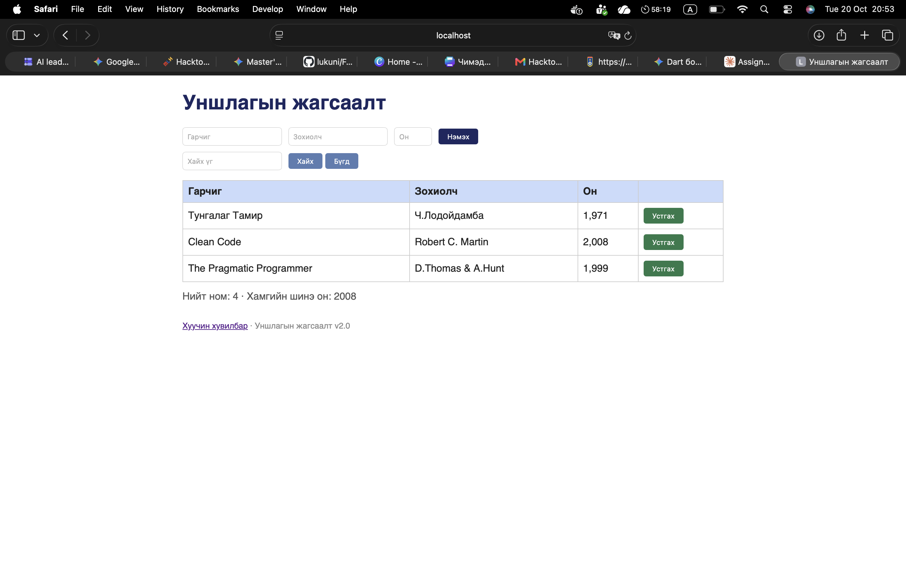

# BUG-01: Хүснэгтийн «Он» баганад он таслалтай (1,999) харагдана

Орчин:  Уншлагын жагсаалт v2.0, Safari 26.1, macOS 26.1, 2026-10-20
Урьдчилсан нөхцөл: node app.js-ийг шинээр асаасан (анхны 3 ном)

## Дахин гаргах алхам
1. Терминалд `node app.js` ажиллуулна.
2. Браузерт http://localhost:3000 нээнэ.
3. Хүснэгтийн «Он» баганыг харна.

Хүлээгдэж байсан: «Он нь 1000-2100 хоорондох бүхэл тоо; хүснэгтэд энгийн тоогоор (жишээ нь 1999) харагдана.»
Бодит үр дүн:     Онууд таслалтай харагдана: «1,971», «2,008», «1,999». Шинээр нэмсэн ном ч мөн адил (1930 → «1,930», 1000 → «1,000»).

Ноцтой байдал: Minor — өгөгдөл зөв хадгалагдаж байгаа ч харагдах хэлбэр спецификациас зөрж, онг мянгатын тоо мэт харагдуулна.
Хавсралт:      screenshots/bug-01.png

Олдсон аялал:  Supermodel
