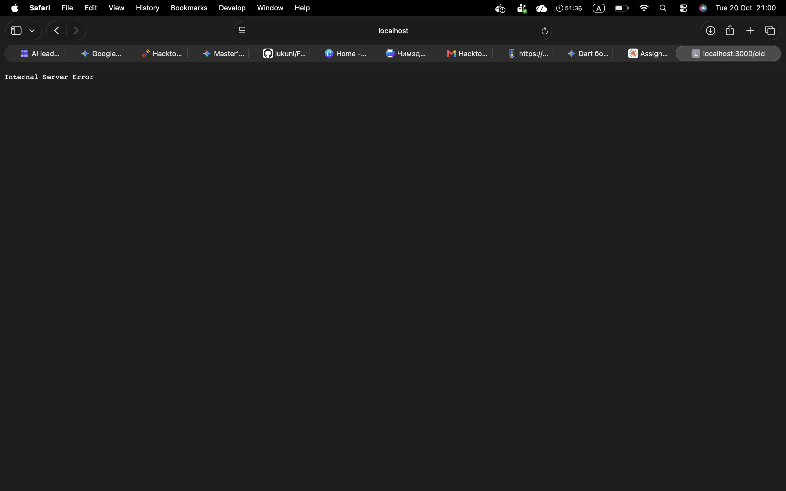

# BUG-04: «Хуучин хувилбар» линк «Internal Server Error» хуудас нээнэ

Орчин:  Уншлагын жагсаалт v2.0, Safari 26.1, macOS 26.1, 2026-10-20
Урьдчилсан нөхцөл: node app.js-ийг шинээр асаасан (анхны 3 ном)

## Дахин гаргах алхам
1. Терминалд `node app.js` ажиллуулна.
2. Браузерт http://localhost:3000 нээнэ.
3. Хуудасны доод талын «Хуучин хувилбар» линк дээр дарна.
4. (API түвшинд) Өөр терминалд: `curl -i localhost:3000/old`

Хүлээгдэж байсан: «бүх хуудас, линк ажиллана.»
Бодит үр дүн:     Хаяг localhost:3000/old болж, хуудсанд зөвхөн «Internal Server Error» гэсэн текст харагдана. curl -i статус: `HTTP/1.1 500 Internal Server Error` (бүтэн гаралт evidence/bug-04-curl.txt-д).

Ноцтой байдал: Major — хэрэглэгчид харагдах линк эвдэрсэн, сервер дотоод алдаа буцаана.
Хавсралт:      screenshots/bug-04.png · evidence/bug-04-curl.txt

Олдсон аялал:  Supermodel
