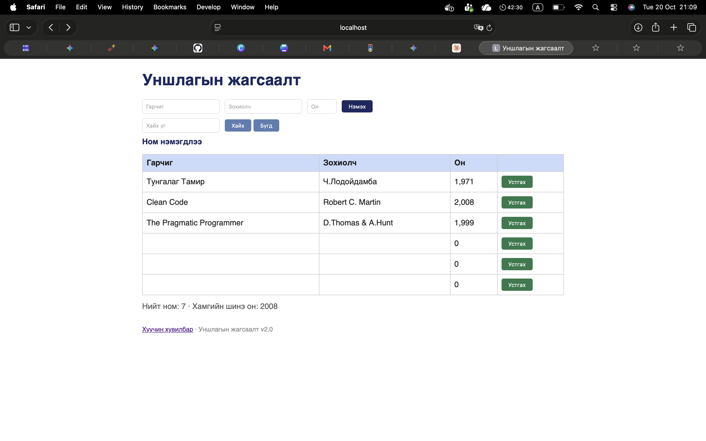

# BUG-05: Бүх талбар хоосон байхад «Нэмэх» дарахад хоосон ном нэмэгдэнэ

Орчин:  Уншлагын жагсаалт v2.0, Safari 26.1, macOS 26.1, 2026-10-20
Урьдчилсан нөхцөл: node app.js-ийг шинээр асаасан (анхны 3 ном)

## Дахин гаргах алхам
1. Терминалд `node app.js` ажиллуулна.
2. Браузерт http://localhost:3000 нээнэ.
3. Гарчиг, Зохиолч, Он талбаруудыг ХООСОН үлдээнэ.
4. «Нэмэх» товчийг дарна.

Хүлээгдэж байсан: «Ном нэмэхэд Гарчиг, Зохиолч, Он гурван талбар бүгд заавал бөглөгдсөн байх ёстой; дутуу бол ном нэмэгдэхгүй, ойлгомжтой алдааны мессеж харагдана.»
Бодит үр дүн:     Гарчиг, Зохиолч хоосон, Он «0» бүхий шинэ мөр нэмэгдэж, «Ном нэмэгдлээ» мессеж гарна. Дахин дарахад ижил хоосон мөр дахин нэмэгдэнэ.

Ноцтой байдал: Major — заавал талбарын шалгалт огт ажиллахгүй тул хүснэгтэд утгагүй өгөгдөл хуримтлагдана.
Хавсралт:      screenshots/bug-05.png

Олдсон аялал:  Couch Potato
